<div style="text-align: center;">

# Avance 1 | Análisis exploratorio de datos

### EDA de un dataset de planograma para negocios pequeños

**Tecnológico de Monterrey** · Maestría en Inteligencia Artificial Aplicada<br>
**TC5035.10 — Proyecto Integrador (Grupo 10)**

**Equipo 48** · **Modalidad:** En equipo · **Fecha:** Octubre 2026

| Integrante | Matrícula |
|---|---|
| Oscar Alberto Ramírez Anaya | A01795438 |
| Germán Eduardo Rodríguez Vázquez | A01796325 |
| Jesús Soto Medrano | A01794746 |

**Profesora:** Dra. Grettel Barceló Alonso · **Asesor:** Dr. Raúl Valente Ramírez<br>
**Sponsor:** Dr. Juan Arturo Nolazco Flores · **Organización:** Bnext

</div>

---

**Entregable:** [`Avance1.48.ipynb`](./Avance1.48.ipynb) ·
[Ver en nbviewer](https://nbviewer.org/github/oscar-ramirez-anaya/Avance1_Equipo48/blob/main/Avance1.48.ipynb) ·
[Reporte PDF](./Avance1.48.pdf) · [Reporte DOCX](./Avance1.48.docx)

## Resumen

Análisis exploratorio de datos (EDA) de la fase de **Entendimiento de los datos** de CRISP-ML(Q) para un
sistema que detecta productos y espacios vacíos en anaqueles de tiendas pequeñas y verifica el
cumplimiento del planograma. Se caracterizan el volumen, la calidad de captura, las clases, la densidad,
la distribución espacial, la separabilidad por color, los duplicados y el estado de cada posición
respecto al planograma, y se valoran pros, contras e implicaciones para el proyecto.

> **Datos sintéticos.** El EDA se construyó sobre un conjunto **sintético** generado dentro de la libreta
> con semilla fija (`SEED = 48`), con anotaciones, planograma de referencia y degradaciones realistas de
> captura (iluminación, desenfoque, ruido, perspectiva, oclusión y duplicados). Las cifras ilustran el
> método; **no contiene imágenes ni datos de Bnext**. El análisis sobre la muestra real se hace en el
> [Avance 2](https://github.com/oscar-ramirez-anaya/Avance2_Equipo48).

| Indicador | Resultado |
|---|---|
| Volumen | **360 imágenes**, **12 570 cajas** (34.9 por imagen), 8 tiendas × 2 muebles, 4 dispositivos |
| Espacios vacíos | **18.9 %** de las posiciones (la clase más frecuente); solo 1.4 % de las imágenes no tiene ningún hueco |
| Estado por posición | **71.4 %** correcto · **18.9 %** faltante · **9.7 %** mal ubicado |
| Calidad de captura | **37.5 %** de las imágenes con algún problema; **59.5 %** en dispositivos básicos |
| Separabilidad por color | Un clasificador solo con color logra **0.97** de exactitud (azar: 0.14) |
| Duplicados | **7.8 %** de las imágenes en pares duplicados: obliga a particionar por tienda y mueble |

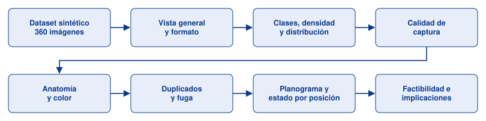

*Etapas del análisis exploratorio.*

---

## 1. Vista general del dataset

Cada captura simula un mueble con 3 a 4 charolas; cada posición puede estar correcta, vacía o con un
producto de otra categoría. Las anotaciones (cajas delimitadoras) y el planograma permiten medir el
cumplimiento por posición.

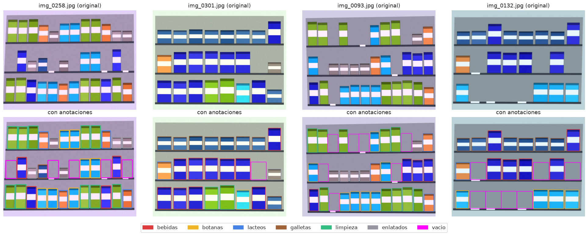

## 2. Resolución, formato y procedencia

Cuatro resoluciones de captura (de 800×600 a 1600×1200), una por tipo de dispositivo, y un número de
imágenes similar por tienda.

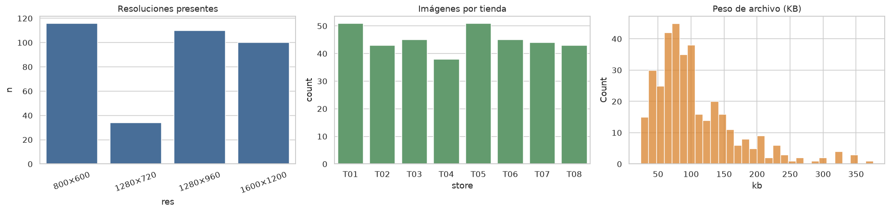

## 3. Clases y espacios vacíos

El **vacío** es la clase más frecuente (18.9 %), lo que lo vuelve la clase crítica del detector; el
desbalance entre clases de producto es moderado.

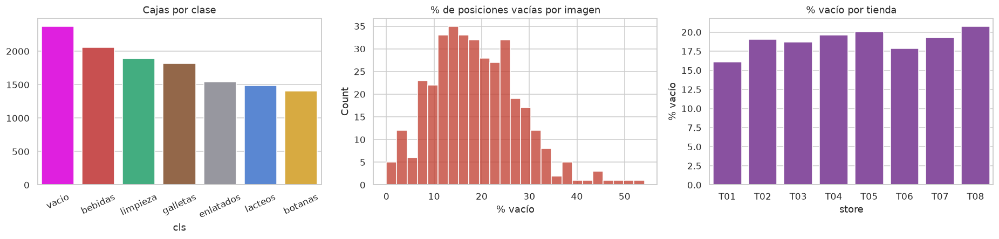

## 4. Densidad y tamaño de los objetos

Entre 25 y 45 objetos por imagen. Ninguna caja queda por debajo de 32 px a 640×480, el tamaño mínimo
habitual de los detectores.

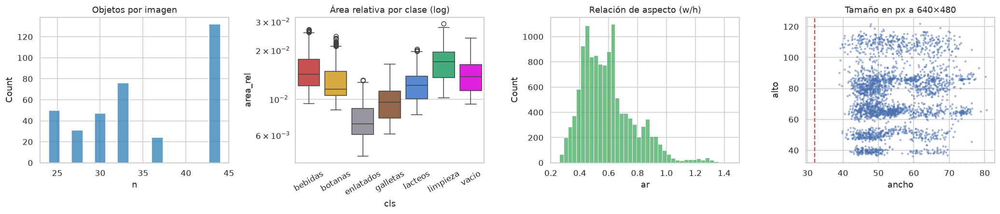

## 5. Distribución espacial

Los objetos, los vacíos y los productos mal ubicados se distribuyen por charola sin una zona dominante.

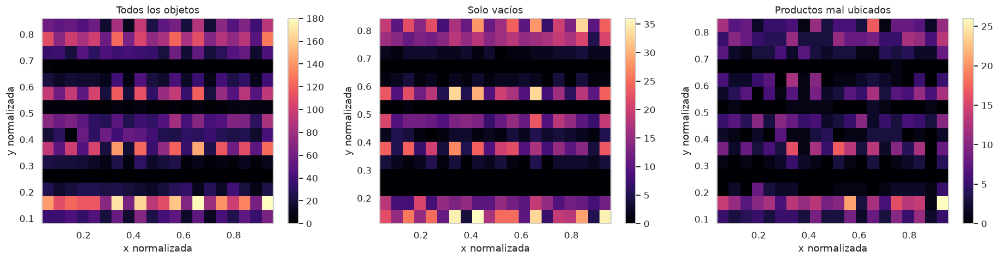

## 6. Calidad de imagen

Brillo, contraste, nitidez (varianza del Laplaciano), ruido y saturación. La nitidez es la principal fuente
de variación y depende del dispositivo: los básicos concentran las capturas borrosas y ruidosas.

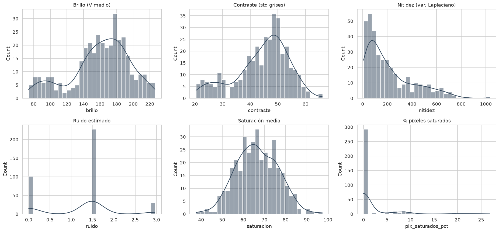

| Por dispositivo | Casos extremos |
|---|---|
| 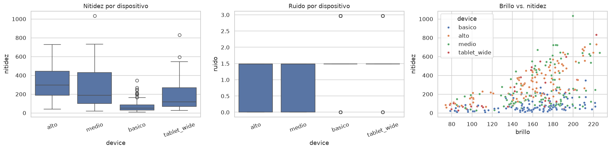 | 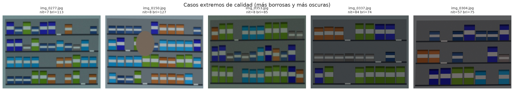 |

## 7. Anatomía de una imagen

Histogramas RGB y de matiz, mapa de nitidez local, bordes de Canny y canal de saturación de una captura.

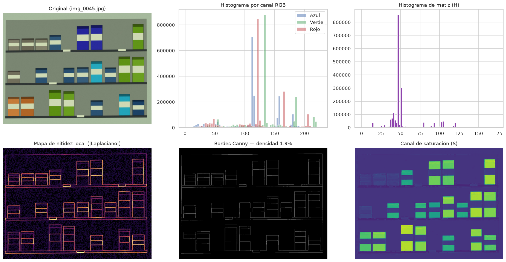

## 8. Color por clase y separabilidad

El perfil de color separa las categorías casi por sí solo (exactitud de 0.97). En datos sintéticos el
color es un atajo; con datos reales debe verificarse para no sobreestimar el desempeño.

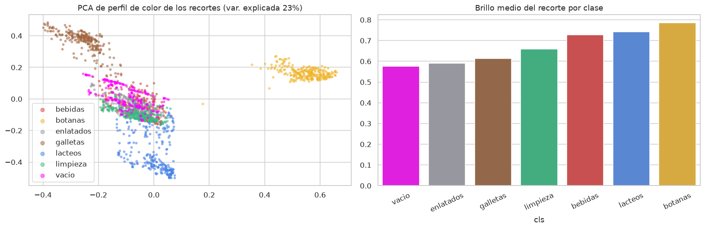

## 9. Duplicados y fuga de información

La distancia de hash perceptual al vecino más cercano detecta pares casi idénticos (7.8 % de las
imágenes). Una partición aleatoria los repartiría entre entrenamiento y prueba, así que la partición debe
agruparse por tienda y mueble.

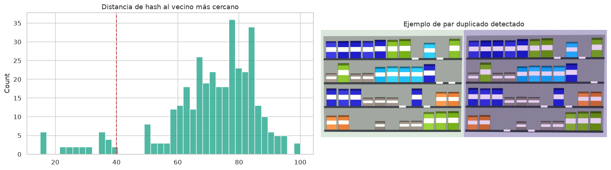

## 10. Planograma y estado por posición

Matriz esperado (planograma) contra observado y porcentaje de cumplimiento por imagen.

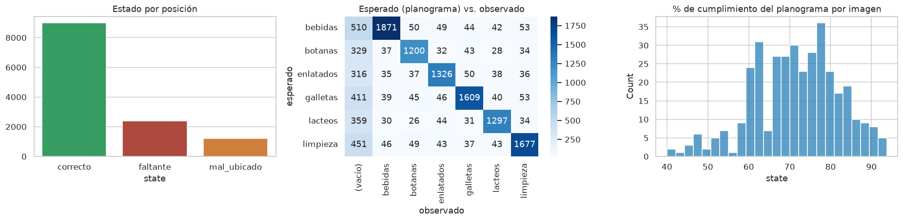

## 11. Factibilidad

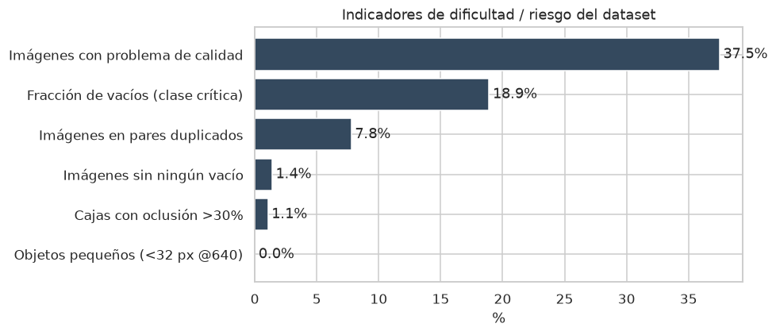

## Conclusiones

- El tipo de conjunto de datos es adecuado para el objetivo: anotaciones por caja más planograma permiten
  medir el cumplimiento por posición.
- El **vacío** debe tratarse como clase de primer nivel.
- La **calidad de captura** depende del dispositivo; conviene filtrar o advertir capturas borrosas.
- Los **duplicados** obligan a una partición agrupada para evitar fuga.
- El siguiente paso es repetir el análisis sobre las imágenes reales de Bnext dentro de su
  infraestructura.

## Notas de consistencia

El reporte y la libreta se redactaron en paralelo y difieren en algunas cifras; la libreta es la fuente
reproducible.

| Concepto | Reporte | Libreta |
|---|---|---|
| Detección de duplicados | dHash 256 bits, P 1.00 / R 0.40 | aHash 64 bits, P 0.93 / R 0.43 |
| Exactitud del clasificador de color | 0.95 | 0.97 |
| Imágenes con al menos un problema de calidad | 38.9 % | 37.5 % |

## Contenido del repositorio

| Archivo | Descripción |
|---|---|
| **`Avance1.48.ipynb`** | Libreta del EDA, ejecutada de principio a fin con salidas y gráficos |
| `Avance1.48.pdf` / `Avance1.48.docx` | Reporte del EDA |
| `figuras/` | Gráficas exportadas de la libreta |
| `POLITICA_DATOS.md` | Acuerdo de manejo de datos con Bnext |

## Reproducir

```bash
pip install numpy pandas opencv-python-headless matplotlib seaborn pillow scikit-learn nbconvert ipykernel
jupyter nbconvert --to notebook --execute --inplace Avance1.48.ipynb
```

El dataset sintético se escribe en `~/week3/data` (configurable con `AVANCE1_DATA_DIR`).
